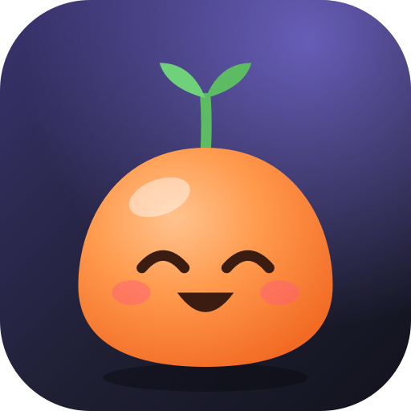
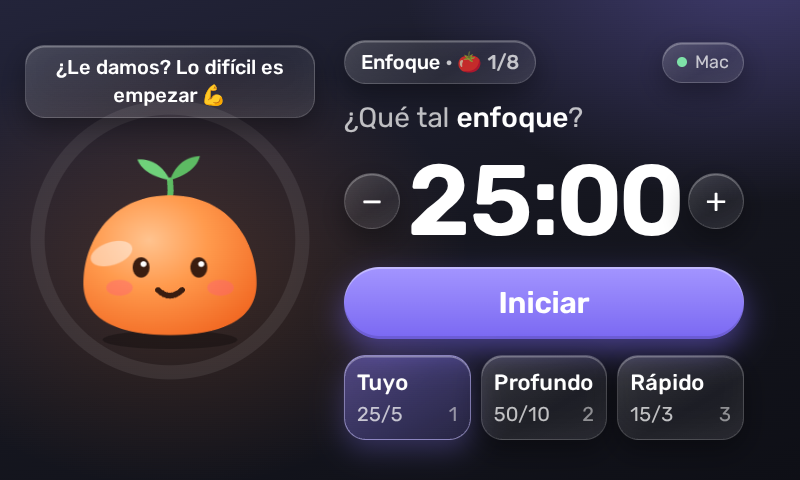
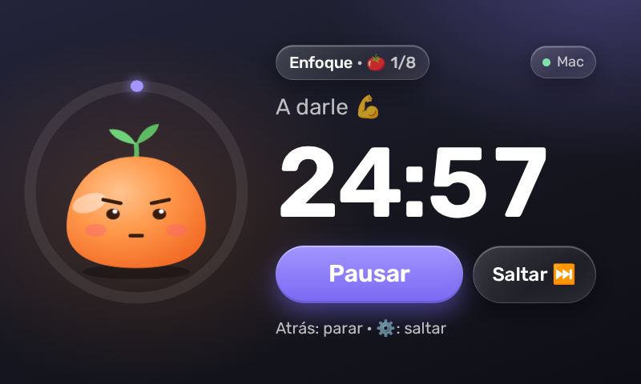
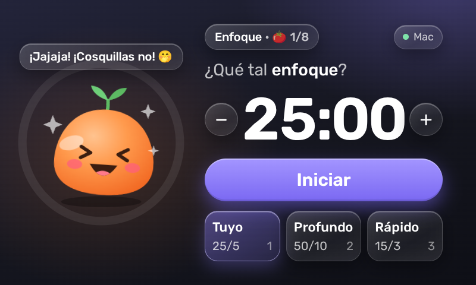
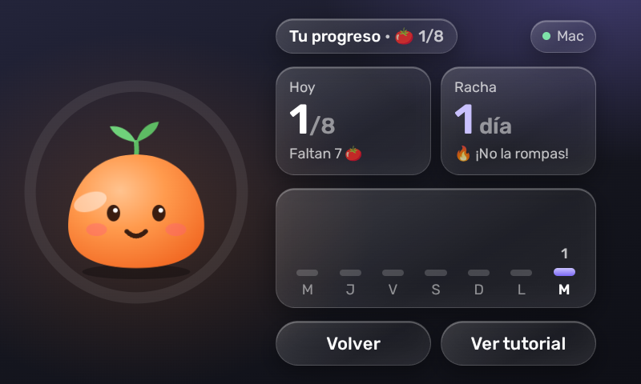
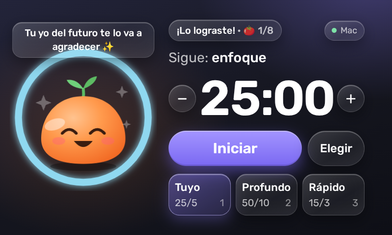
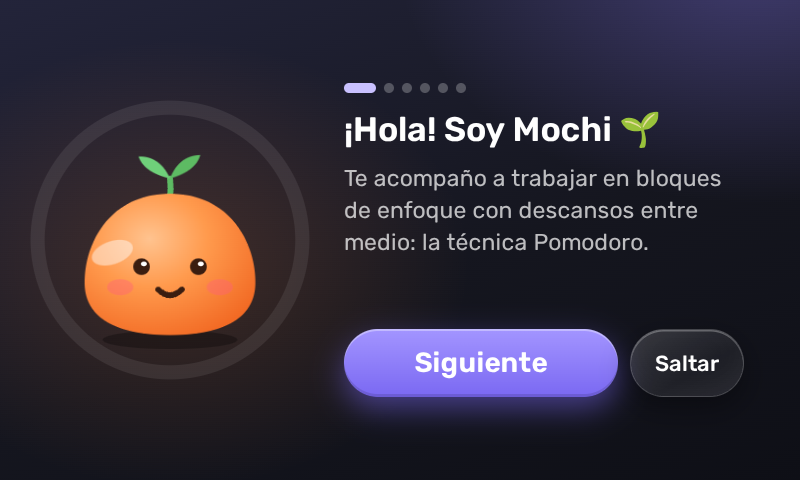

<p align="center">
  
</p>

<h1 align="center">pomo-thing</h1>

<p align="center"><strong>Pomo</strong>: a Pomodoro timer with a little companion, Mochi, for the Spotify Car Thing running <a href="https://bridgething.com">bridgething</a>.</p>

<p align="center">
  
  
  
  
  
  
</p>

- Suggests focus and break blocks, with presets (25/5, 50/10, 15/3) and the knob to adjust minutes.
- Mochi chats, fidgets, jumps when tapped and laughs when tickled. Its sprout grows with every pomodoro and blooms at your daily goal.
- Daily count, streak and a 7-day chart.
- Optional macOS notification with sound when a block ends (desktop extension, `osascript`).
- Spanish and English.

## Install

Add this source in the bridgething app: `https://gmejiae.github.io/pomo-thing/catalog.v1.json`

The desktop extension only asks for `run:osascript`, to show the notification.

## Develop

```sh
bun run dev            # develop against a connected Car Thing
bun run dev:device     # show the dev server on the Car Thing screen
bun run push           # build and install to the device
bun run check          # typecheck, build and validate the catalog
```

Pushing to `main` publishes to the `gh-pages` branch (Settings > Pages: branch `gh-pages`, folder `/ (root)`).
